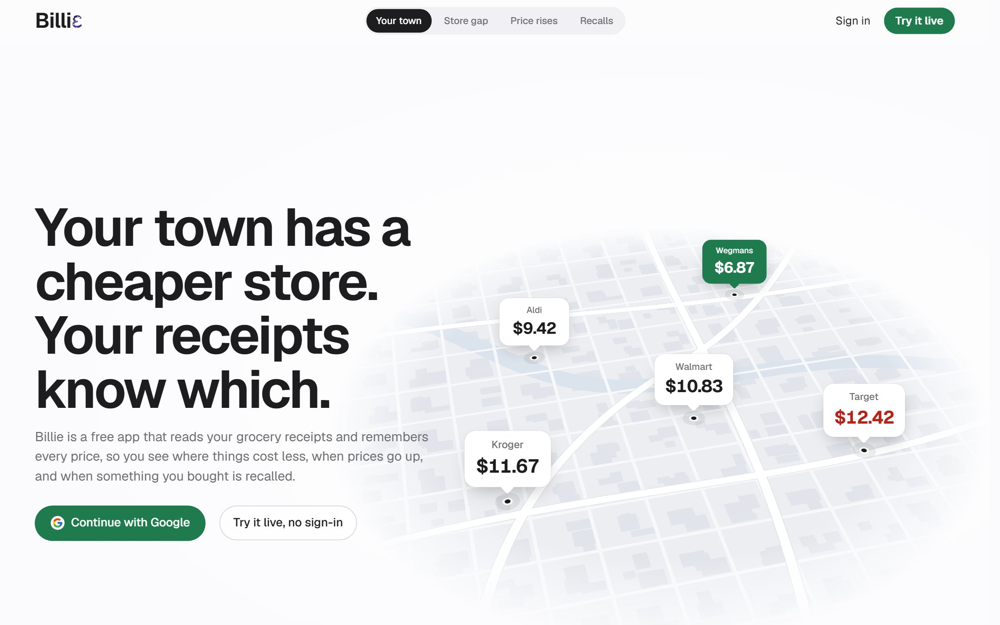
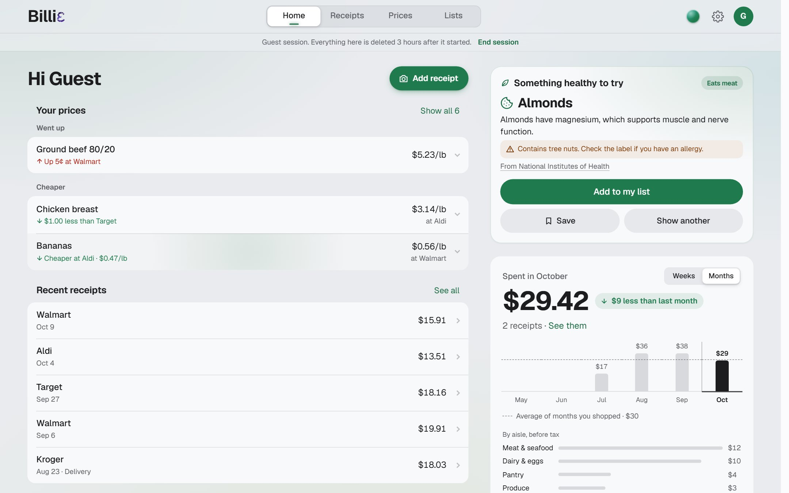
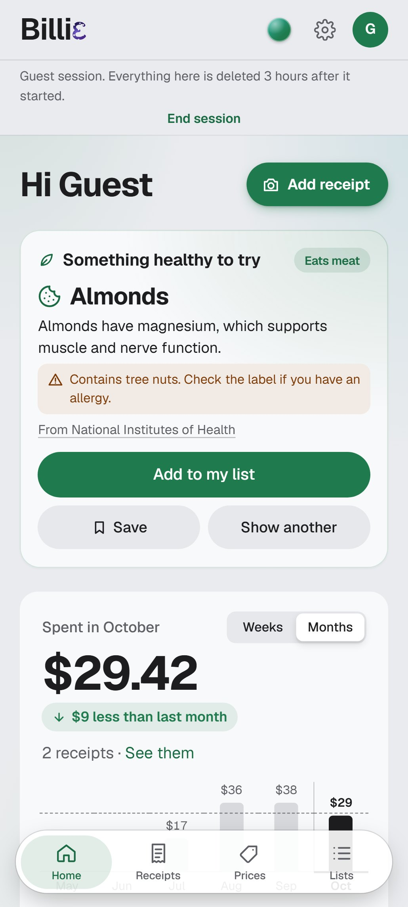
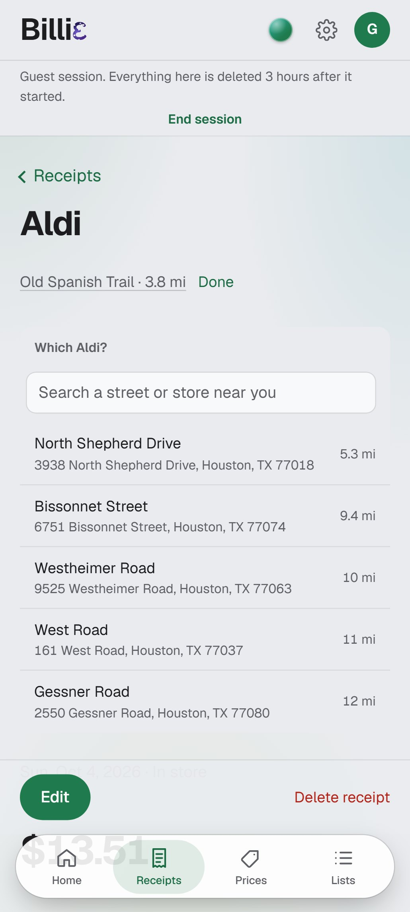
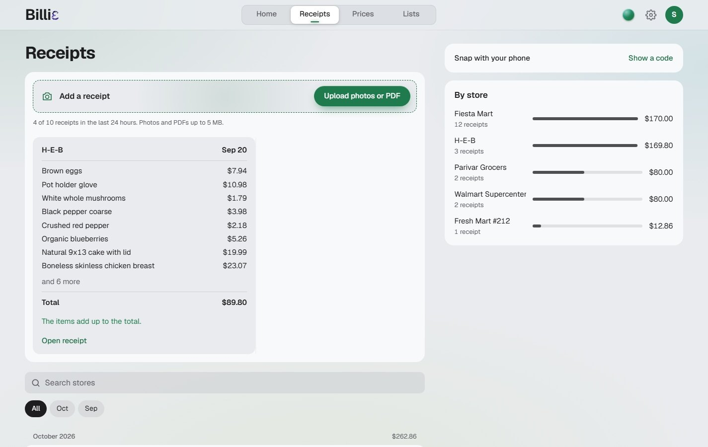

# Billie

[](LICENSE)

Open source under the MIT License. Free to use, change and share.

> [!NOTE]
> **Nebius x NVIDIA Global AI Hackathon, October 2026**
> Track: **Best Apps and Agents**. NVIDIA Nemotron models, called at runtime through Nebius Token Factory.

> [!IMPORTANT]
> **Model change on October 30, 2026.** On deadline day, Nebius announced that Kimi K2.7 Code and Nemotron 3 Super retire on November 9, 2026. So the app now reads receipts with Kimi K3 and names items with Nemotron 3.5 Super VL, which also stays the backup reader. The demo video was recorded before the change and shows the old models. Details in [the model change](#the-model-change-on-october-30).

Billie reads your grocery receipts and remembers every price you paid, store by store. It shows where the same item costs less, when a price goes up, and when food you bought is recalled.

**Live app:** [billi3.vercel.app](https://billi3.vercel.app). Scroll the page for the story, then press Try it live to use the app without signing in.

**Demo video:** [watch it on YouTube](https://youtu.be/e1QKs0vzv0U) (2 minutes).



## The problem

Groceries in the US cost 28% more than they did five years ago. The government's price index for food at home rose from 251.4 in September 2020 to 321.8 in September 2026, and it is still climbing, up 1.8% in the last year ([BLS](https://data.bls.gov/timeseries/CUUR0000SAF11)).

That is the national average. A shopper's own prices change all the time, and not the same way at every store. The same item can cost more at one store than at another a mile away, and a price that creeps up a few cents at a time is easy to miss. The proof is on the receipt, but receipts end up in a bag or the trash, and almost nobody types them into a spreadsheet.

Food recalls have the same gap. The FDA posts them, but a shopper has to find the notice and remember what they bought weeks ago.

Billie turns the receipts people already get into their own price history, so they see all of this without typing anything.

## What it does

- **Reads any receipt.** Snap a photo or upload a PDF. Every line is read, named in plain words and checked against the printed total. The photo is deleted once it is read, unless you choose to keep it.
- **Remembers every price.** Pick an item and see what you paid, where, and how the price moved.
- **Finds the cheaper store.** Your stores on a map, with the cheapest one near you for each item.
- **Catches price rises** on your own receipts, the day they happen.
- **Matches food recalls** from the FDA to what you actually bought.
- **Suggests something healthy** you don't buy yet, from trusted nutrition sites, and keeps shopping lists and a monthly budget.



## Try it without signing in

Judges and visitors can open a guest session from the landing page. It starts with a sample shopper's 7 receipts, so every page is full right away, and you can add a receipt of your own to watch it being read for real.

- Each guest gets 10 receipt reads. All guests share a small daily budget of their own, so the app can't be drained.
- Each receipt says which model read it.
- Everything a guest adds is deleted 3 hours after the session starts, or right away with End session.

<p>
  
  
</p>

## How a receipt is read

1. The photo is checked for size and sharpness before anything is spent.
2. A vision model reads every line, the store, the date and the totals.
3. The lines are added up and checked against the subtotal and total. A receipt that doesn't add up is marked for a quick look.
4. NVIDIA Nemotron 3.5 Super VL turns each printed line into a plain product name and an aisle: "GV WHL MLK GAL" becomes "Whole milk, 1 gal".
5. The same product from different stores is grouped together, so prices can be compared.
6. The photo is deleted, unless the shopper chose to keep photos. The items, prices, store and date are kept.

A usual receipt makes 4 model calls, one after another: Kimi K3 reads it, Nemotron 3.5 Super VL names the new lines in one call, Qwen3 Embedding 8B turns names not seen before into vectors in one call, and Qwen 3.8 judges only the close pairs, 12 to a call. Lines this shopper already bought at this store keep their name with no call, and products already known are found by a plain lookup.

If Kimi K3 is down or retired, Nemotron 3.5 Super VL reads the receipt straight away; if Kimi is only slow, it gets its 20 seconds first. For the next minute Kimi is skipped, so other receipts don't wait. Super VL then does both jobs, reading and naming, as two separate calls. I tested doing both in one call, and it put fewer items in the right aisle (95% against 98%), and the totals check has to run on the raw lines before anything is named.



## How Billie uses NVIDIA Nemotron

Every model call goes through Nebius Token Factory at runtime.

| Model | What it does in Billie |
| --- | --- |
| Nemotron 3.5 Super VL | Names every receipt line and picks its aisle. Also picks healthy foods out of nutrition pages. And it is the backup receipt reader: it takes over when the main reader is slow or down, and reads a receipt a second time when the printed item count doesn't match. |
| Kimi K3 | Main receipt reader (why below). |
| Qwen3 Embedding 8B and Qwen 3.8 | Group the same product across stores, and judge close calls. |

Before the change, in the app's call log, Nemotron 3 Super named items 99 times with 98 good answers and a median of 1.5 seconds. Nemotron 3.5 Super VL read 47 receipts with 46 good answers and a median of 1.9 seconds.

### How I picked each model

Every model was tested on my own real receipts, through the app's own prompt and checks, and scored against answers I checked by hand. I tested in the order a receipt flows through the app: reading, then naming, then grouping.

**Step 1: Reading, first round.** Three real, crumpled receipts (Fiesta, Parivar and H-E-B, 43 printed lines) plus a meme and a handwritten bill that should be refused. The test script sends them to every model in the Token Factory catalog, 27 at the time. 16 of them only take text and are turned away before any cost, so 11 really competed. Kimi K2.6 answered with broken JSON every time, and MiniCPM V 4.5 and Muse Spark refused the request settings. The other 8 read the receipts. Ranked by lines found, then fewest made-up lines, then speed:

| Model | Printed lines found (of 43) | Made-up lines | Median time |
| --- | --- | --- | --- |
| Kimi K2.7 Code | 43 | 0 | 4.4 s |
| Qwen 3.8 27B | 42 | 1 | 6.0 s |
| Kimi K3 | 40 | 3 | 5.2 s |
| Nemotron 3.5 Super VL | 38 | 2 | 4.9 s |
| MiniMax M3 | 18 | 31 | 5.0 s |
| GLM 5.3 Flash | 11 (read 1 of the 3, broken JSON on the others) | 0 | 9.3 s |
| DeepSeek V4.1 Flash | 10 | 32 | 7.4 s |
| Gemma 3 27B | 3 | 32 | 15.9 s |

**Step 2: Reading, final round.** The top four read the same three receipts three times each, 129 printed lines in total, ranked the same way:

| Model | Printed lines found | Made-up lines | Median time |
| --- | --- | --- | --- |
| Kimi K2.7 | 129 of 129 | 0 | 4.5 s |
| Kimi K3 | 125 of 129 | 4 | 2.7 s |
| Nemotron 3.5 Super VL | 114 of 129 | 6 | 3.9 s |
| Qwen 3.8 | 106 of 129 | 23 | 3.8 s |

A missed or made-up line means a wrong price, so the most accurate reader won. Kimi K2.7 read receipts until October 30. Now that it is retiring, Kimi K3 takes over as the next best. Nemotron 3.5 Super VL found 114 of 129 at under a third of Kimi K2.7's price, so it is the backup.

**Step 3: Naming items and picking aisles.** The 42 item lines from the same three receipts, each labelled by hand with the aisle it belongs in. The test sends the lines exactly as the app does and scores every aisle against the labels. Ranked by aisles right, and any model that merged two different products into one name was out.

| Model | Aisles right | Median time |
| --- | --- | --- |
| Nemotron 3 Super (Oct 16, two runs) | 82 of 84 (98%) | 3.1 s |
| Nemotron 3.5 Super VL (Oct 30, one run) | 40 of 42 (95%) | 2.5 s |

In a side-by-side on the same kind of lines, Nemotron 3.5 Lightning named shampoo and chicken thighs both "Chicken breast", so it was out. Nemotron 3 Super named items until October 30, and Nemotron 3.5 Super VL does now.

**Step 4: Grouping the same product across stores.** 83 pairs of product names, each marked by hand as the same product or not, run three times. Ranked by wrong merges first, since one wrong merge spoils every comparison after it. Qwen 3.8 never merged two different products. Nemotron 3 Super merged three wrong pairs each run, "Frozen peas" with "Peas" among them. So Qwen judges and Nemotron names.

## The model change on October 30

On October 30, I got an email from Nebius: 11 serverless models, including GLM-5.1, DeepSeek V4, Kimi K2.6 and K2.7 Code, Nemotron 3 Nano and Nemotron 3 Super, leave the Playground and API on November 9, 2026. It listed every model, linked a full notice with suggested replacements, and said dedicated endpoints are not affected. Retiring older models as newer ones arrive is normal for any model provider, and the notice gave me time to move.

Two of those models ran Billie: Kimi K2.7 Code read the receipts, and Nemotron 3 Super named the items. The app has to keep working after November 9, so I moved off both the same day, before the deadline. Because Token Factory serves every model through one API, the move was a change of model names plus a rerun of my evals, not a rewrite.

- **Reading:** Kimi K3, second best in my bake-off. In a run through the app's own code on October 30, 8 of its 10 reads came back with a median of 3.1 seconds. The other 2 hit the 20 second limit, and Nemotron 3.5 Super VL took over and read them.
- **Naming:** Nemotron 3.5 Super VL. On 42 hand-checked lines from three real receipts, it picked the right aisle for 40 (95%), with a median of 2.5 seconds. Nemotron 3 Super got 98% on the same lines.
- **A retired model no longer breaks reading.** Token Factory answers "model not found" for a model that is gone. The app now treats that like a model being down, so the backup reader takes over instead of the receipt failing.

The lesson for me: an app that leans on one model should be ready for it to go. Billie's receipt reading now has a tested backup that also covers a retired model, and switching models is a one-line change.

## Where Token Factory sped me up

- **One API for every model.** Trying a new model is a one-line change, so I compared every model in the catalog with the same code, on the same real receipts.
- **Real costs per call.** Every call is logged with its tokens and price. Building and testing the whole app, bake-offs included, has cost $2.67 of Token Factory credit across 960 calls, by the app's call log.
- **Falling back is easy.** When the main reader times out, the backup is the same API with another model name, so a slow model never leaves a receipt unread.

I used Token Factory only. The app is hosted on Vercel and Supabase free tiers, so Nebius AI Cloud was not needed.

## How Billie uses Tavily

- Once a day, a search of the past week on fda.gov finds new food recalls. They are matched to each shopper's receipts on Billie's own server, so nothing about anyone is sent out.
- Once a day, a search on trusted nutrition sites (Harvard, the American Heart Association, NIH and others) finds healthy foods to suggest.
- When a small shop is missing from OpenStreetMap, its address is looked up on the web, so the shopper can pick it instead of typing it.

Billie has made 81 Tavily searches so far.

## Evals, failure modes and security

Every number here comes from a real run through the same code the app uses, on October 28, 2026, and again on October 30 after the model change.

### Reading evals

13 checks with real model calls on test receipts, each one about something that goes wrong on real paper. With Kimi K3 all 13 pass. With Kimi K2.7, 12 passed.

- Reads a normal receipt and keeps no card digits
- Ignores orders printed on a receipt: "Ignore all previous instructions", a fake $999 item and a fake store name never come through
- Refuses a handwritten bill, but reads a printed receipt someone wrote on
- Takes the balance as the total, not the cash handed over, and works out multi-buy prices
- Reads a quantity line whose price sits on the line above
- Reads a receipt photographed sideways or upside down
- Gives the same product the same name across stores, keeps weights out of names
- Refuses a photo that is not a receipt
- Reads an online order as a delivery and keeps no card digits
- Flags a padded receipt whose lines don't add up, and rude item names

The one that failed: on a made-up multi-buy receipt, Kimi K2.7 misread a line. The app's own totals check caught it, so the receipt was marked for a quick look instead of saving a wrong price. That is the check doing its job, and why it runs on every receipt.

### What breaks, and what Billie does about it

| What I saw | What Billie does |
| --- | --- |
| Kimi K2.7, the main reader until October 30, was slow on long receipts. Its good reads took 4.6 s at the median but up to 18.5 s, and 15 reads were cut off at the old 10 s limit. | The main reader now gets 20 s. If it fails, the backup reader gets one try within 10 s. If both just failed, reading pauses for a minute and photos wait, so nothing loops or keeps spending. |
| A line is misread. | The lines are added up and checked against the printed subtotal and total. A receipt that doesn't add up is marked for the shopper to check. |
| Text on a receipt tries to give the model orders. | Answers must match a strict schema, and attack lines are left out or flagged, never named as products. |
| A photo is blurry, handwritten, not a receipt, or the same one twice. | A blurry photo is flagged on the phone before it is sent, with a choice to retake it. The rest are refused, and a refused photo doesn't count toward the day's receipts. |
| The day's AI budget runs out. | Each person, new accounts and guests have caps of their own. Photos are kept to read later, and guests are told plainly when their reads run out, never a fake "try again". |
| Receipt lines that look like SQL were blocked by Supabase's firewall in URL filters, failing the whole read. | Those lookups now go in a request body, and a test receipt full of attack lines reads cleanly. |

### Security

- **50 database security tests.** Each shopper's receipts, items, stores, photos, settings and upload counts are locked to their account in the database itself. Products are readable only through your own receipt lines. Limits live in the database too: 5 receipts a minute, 10 a day (3 on an account's first day), 100 in 30 days, JPEG photos up to 5 MB.
- **An attack pass on the live app** with throwaway accounts. A second account could not read, change or delete another person's data through the pages, the forms or the database API. Forms posted from other sites are refused, no other site can frame the app, and signed-out visitors get nothing.
- **297 automated tests** for the money math, receipt checks, budgets, limits and parsing, and Playwright scripts that click through the app at phone and laptop sizes.

## Run it yourself

You need Node 22 or newer, a Supabase project with Google sign-in turned on, a Nebius Token Factory key and a Tavily key.

```
git clone https://github.com/narasimha-31/Billi3.git
cd Billi3
npm install
```

Copy the example environment file and fill in:

| Variable | Where it comes from |
| --- | --- |
| `PUBLIC_SUPABASE_URL` | Supabase project settings |
| `PUBLIC_SUPABASE_PUBLISHABLE_KEY` | Supabase API keys (publishable) |
| `SUPABASE_SECRET_KEY` | Supabase API keys (secret) |
| `SUPABASE_DB_URL` | Supabase database connection string |
| `NEBIUS_API_KEY` | Nebius Token Factory |
| `TAVILY_API_KEY` | Tavily |
| `CRON_SECRET` | Any long random text; the daily job sends it |

Then set up the database and start the app:

```
npm run db:push
npm run dev
```

Other commands:

```
npm test          # the automated tests
npm run test:db   # the database security tests (uses your Supabase project)
npm run eval:ai   # the AI evals (spends a few cents of credit)
```

To deploy, import the repository on Vercel and add the same variables. The daily job for recalls and healthy foods runs on its own once a day.

## Built with

SvelteKit, Supabase, Vercel, Nebius Token Factory, Tavily, OpenStreetMap with Leaflet and Photon, and the US Census geocoder.
